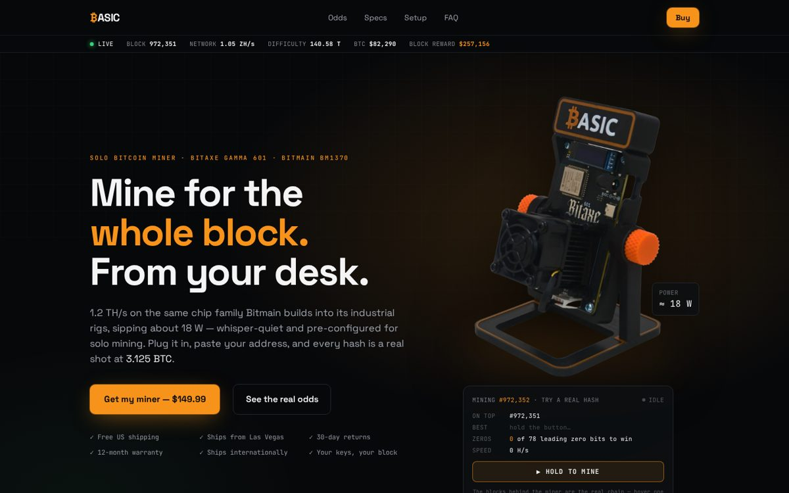
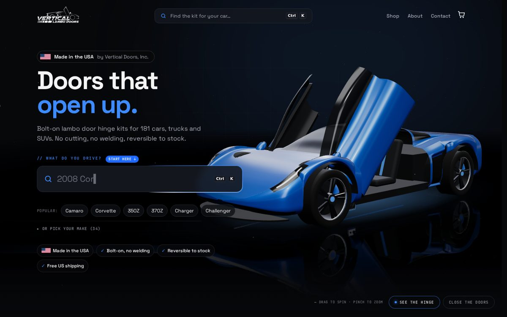
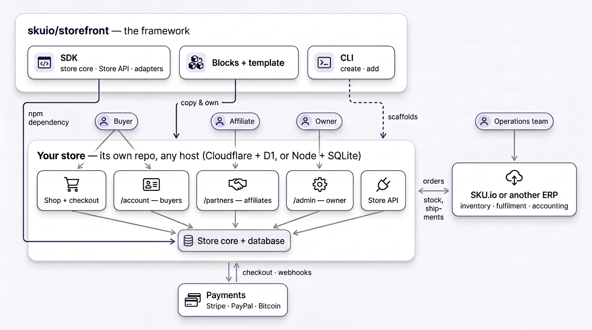
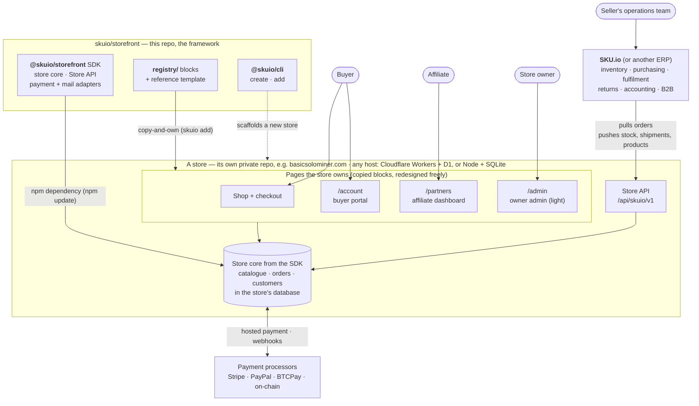

# SKU.io storefront kit

A self-contained e-commerce platform for coding agents to build stores on:
an Astro site with its own SQL database, a store core that owns
catalogue, checkout, orders, payments and the buyer portal, and a **Store
API** so an operations system (SKU.io first) can pull orders and push
inventory, fulfilments and products. Payments and mail are adapters. Think
WooCommerce without WordPress, and without being tied to any processor or
any host: it deploys to Cloudflare Workers + D1 by default, or to any Node
server with a SQLite file (`STORE_HOST=node`).

```
npx @skuio/cli create my-store
cd my-store && npm install
npx wrangler d1 create my-store           # paste the id into wrangler.jsonc
npm run db:migrate:local && npm run seed  # schema + demo catalogue into the local D1
cp .dev.vars.example .dev.vars            # manual payments + console mail work with no keys
npm run dev
```

Not on Cloudflare? Any Node host works the same way, with the database in one
SQLite file:

```
export STORE_HOST=node DATABASE_PATH=data/store.db
npm run seed:sqlite                       # schema + demo catalogue into the SQLite file
npm run dev                               # or: npm run build:node && npm run start:node
```

Then open `CLAUDE.md` in the new store. It explains the shape of the project
to whatever agent you point at it, and names the one test that has to stay green.

## Built with the kit

| | |
|---|---|
| [](https://basicsolominer.com) | [](https://www.verticallambodoors.com) |
| **[basicsolominer.com](https://basicsolominer.com)** — one product sold direct: a dark, interactive single-page store with PayPal express, on-chain bitcoin, discount codes and a partner (affiliate) program. | **[verticallambodoors.com](https://www.verticallambodoors.com)** — a 181-product catalogue moved off WooCommerce with its legacy URLs kept, vehicle search, and SKU.io driving stock and shipments. |

Each is its own private repo on Cloudflare Workers + D1: the same SDK and
blocks underneath, a completely different store on top.

## How it fits together



<details>
<summary>The same diagram as text (Mermaid)</summary>



</details>

**The kit** is this repo. **A store** is a separate private repo that depends on
the SDK from npm and owns copies of the blocks, so a store has no git
relationship to the kit. **SKU.io** never runs inside the store. It connects
from outside as a client of the Store API: the owner approves the connection at
`/admin/connect`, SKU.io polls new orders, stamps its own order number back, and
pushes stock, shipments (the store emails tracking) and, if it owns the
catalogue, products and categories.

## Who uses what

| Person | Where | What they do |
|---|---|---|
| Buyer | `/account` (emailed sign-in link), `/account/order-lookup` (guest) | Order history, tracking, reorder |
| Partner / affiliate | `/partners` (emailed sign-in link) | Traffic, funnel, sources, link builder, commission owed |
| Store owner | `/admin` (password) | Orders and payments at a glance, partners and commissions, approve or revoke the connections that may use the Store API. Read-only on purpose |
| Seller's operations team | **SKU.io**, not the store | Inventory, purchasing, fulfilment and shipping, returns, accounting, B2B. Everything that changes stock or ships a box |

The seller side is deliberately split. The store's `/admin` is just enough to
run a shop that has no operations system yet and to see that orders are flowing.
Real operations live in the ERP, and the ERP pushes the results back into the
store.

## Portability: your ERP, your host, your data

A store built on the kit is not locked to SKU.io, to a host, or to the kit.

**Any ERP or OMS.** The store talks to operations systems only through the
Store API, a versioned contract (`docs/store-api.md`, OpenAPI in `docs/api/`)
served at `/api/store/v1` (and at `/api/skuio/v1`, the same API at the path
SKU.io calls). SKU.io is one client of it, with no private hooks. Another
system needs a connector that does five things:

| Step | Call |
|---|---|
| Read new orders | `GET /orders?updated_since=…` |
| Write its own order number back | `PATCH /orders/{id}` with `external_reference` |
| Send shipments and tracking (the store emails the buyer) | `POST /orders/{id}/fulfillments` |
| Send stock levels | `PUT /inventory` |
| Optionally own the catalogue | `PUT /products`, `PUT /categories` |

Against any ERP with a usable API (NetSuite, Odoo, Cin7, QuickBooks Commerce…)
that is days of work, not weeks, and an integration platform such as n8n can do
it without code. The owner approves each system once at `/admin/connect` (any
`client_id`; SKU.io's is `skuio`), and each gets its own revocable key, so an old
and a new ERP can run side by side during a switch.

**Any host.** Cloudflare Workers + D1 or any Node server with SQLite (see
"How a store works" above); moving between them is copying the database.

**Your data.** The store's database is plain SQLite: catalogue, customers,
orders, payments, fulfilments, discount codes, partners. `wrangler d1 export
<db> --remote --output store.sql` (or copying the SQLite file on Node) gives a
complete dump any system can import, and the Store API can read every order and
product for a live migration.

## Backups: set one up for every live store

The store's database is the system of record for its orders and customers
(the operations system keeps a copy of orders, not of sessions, partners or
store settings). **The kit does not back it up for you**, and nothing should go
live without a backup you have restored at least once.

What exists by default:

- **Cloudflare D1** keeps Time Travel: restore the database to any minute in
  the last 30 days (Workers Paid; 7 days on Free) with
  `wrangler d1 time-travel restore <db> --timestamp=…`. It covers a bad deploy or
  deleted rows. It does **not** cover deleting the database, losing the account,
  or anything older than the window, and it is not a copy outside Cloudflare.
- **A Node host** has nothing: the SQLite file is the only copy.

Suggestions, cheapest first:

1. **Nightly export to object storage you control.** `npm run backup` (the
   template's `scripts/backup.mjs`) writes a gzipped SQL dump — `wrangler d1
   export` on Cloudflare, SQLite's online backup on Node — and uploads it to
   `BACKUP_S3_URI` (any S3-compatible store: AWS S3, Cloudflare R2, Backblaze B2,
   Wasabi) with the `aws` CLI. Run it from cron, a scheduled GitHub Action or an
   existing backup server. Give it write-only credentials and let a bucket
   lifecycle rule expire old dumps (30–90 days).
2. **Continuous replication on Node.** Litestream streams every SQLite change
   to S3, so a lost server loses seconds, not a day.
3. **Restore drills.** A backup is only real once it has been restored: load the
   latest dump into a scratch database (`wrangler d1 execute <scratch> --file`,
   or `sqlite3 scratch.db < dump.sql`) and check the order count against the
   live store's `GET /health`.
4. **Alert on silence.** Have the job report success somewhere you watch, and
   alert when no fresh dump has landed in 26 hours.

## What's in here

| Path | What | Published as |
|---|---|---|
| `packages/sdk` | The store core (`/store`), the Store API handler (`/api`), payment adapters (`/payments`, `/payments/stripe`, `/payments/paypal`, `/payments/btcpay`, `/payments/manual`), mail adapters (`/mail`, `/mail/sendgrid`, `/mail/console`), the D1 schema (`db/migrations`), and the catalogue/routing/money/cart primitives (`.`). Framework-agnostic. | `@skuio/storefront` |
| `packages/cli` | `create` a store from a template, `add` blocks from the registry. | `@skuio/cli` |
| `registry/` | UI blocks: source of truth for everything under a store's `src/components` and `src/pages/api`. | copied into stores by `skuio add` |
| `templates/default` | The reference store. Built from the registry; a complete, deployable site with a demo catalogue. | copied by `skuio create` |
| `docs/` | `store-platform.md` (architecture, runtime, env), `store-api.md` + `api/store-api-v1.openapi.yaml` (the contract). | |

## The model: SDK as a dependency, UI as owned code

A store created with the CLI is a plain project. It **depends on**
`@skuio/storefront` from npm, so the store core, the Store API and the
adapters update with `npm update`. It **owns** every component and page
outright — they were copied in, and they are the store's to redesign.
`skuio add <block>` pulls a fresh copy of a block when you want one; it never
overwrites without being asked.

There is no theme system. The reference template is one good store, and the
blocks are the pieces it is made of. Give an agent `CLAUDE.md` and a brief and
it will build the design; the store core, the checkout and the guardrail test
stay underneath.

## How a store works

- **Hosting** is one seam, `src/lib/host.<STORE_HOST>.ts`, which supplies the
  database and the platform's bindings: `cloudflare` (a Worker with D1, the
  default) or `node` (any Node server; one SQLite file at `DATABASE_PATH`,
  migrated on boot). Same SQL, same code, same guardrail test on both; CI runs
  it on each. Another host is another `host.*.ts` file.
- **Catalogue** lives in the store's database. Seed it from `src/data/*.json`
  with `npm run seed`, or let SKU.io push it through `PUT /products` and
  `PUT /categories`. Availability comes from `PUT /inventory`.
- **Checkout** is the store's own page: contact, address, shipping method.
  `POST /api/checkout` creates the order (priced from the database) and hands
  it to the payment adapter — Stripe hosted Checkout in payment-only mode,
  PayPal (Orders v2), BTCPay Server (Bitcoin / Lightning), or `manual` (pay
  later). A store can offer several; the buyer picks at checkout.
- **Discount codes** are the store's own (`discounts` in the config), priced
  into the order under any processor. A code can attribute sales to a
  partner, with the commission snapshotted on the order and a private
  partner report at `/partners/<partner>/`. The processor's webhook marks the order paid; the
  buyer gets a confirmation email.
- **Orders** are the system of record for the buyer. SKU.io reads them with
  `GET /orders?updated_since=…`, stamps its own number back, and pushes
  shipments; the store emails tracking.
- **Portal**: sign-in by emailed link, order history with tracking, reorder.
  Guest lookup by order number + email.
- **Attribution**: first and last touch (utm tags, ad click ids, referrers)
  ride on every order's metadata as `src_first` / `src_last`, so the operations
  system knows which channel sold it.
- **Express checkout**: PayPal / Venmo / Pay Later buttons beside the buy
  button (`paypal-express` block). The address comes from the buyer's PayPal
  account, and the store refuses to capture if the approved amount differs
  from its own price.

## Security model

- The buy form and the cart carry **SKUs and quantities, and no price**.
  `/api/checkout` prices every line from the database.
- Card data never touches the store: the processor's hosted page collects it.
- **The Store API cannot create orders.** Orders come only from the store's own
  checkout, priced from its database. The API reads orders, stamps a reference,
  records a payment or cancellation and adds shipments; a leaked key cannot
  invent a sale or change what was bought.
- Each connection's key is limited to the scopes the owner approved (orders,
  payments, fulfillments, inventory, catalog), enforced per endpoint; marking an
  order paid needs `payments`, approved separately; keys are stored only
  as hashes and can be revoked at `/admin/connections`. The `STORE_API_KEY`
  break-glass secret is compared in constant time; the order's buyer-facing
  access key never leaves the store.
- Sessions and magic links are stored as HMAC hashes (`SESSION_SECRET`).
- Secrets are platform secrets (Worker secrets, or the process environment on
  Node), read through `readEnv`; nothing is committed.

## Developing the kit

```
npm install
npm run build              # sdk + cli
npm test                   # sdk unit tests (SQLite behind the D1 driver interface)
npm run check              # types, every workspace
npm run sync:template      # registry -> templates/default (--check in CI)
npm run template:build
npm run template:e2e       # local D1: cd templates/default && npm run db:migrate:local && npm run seed
# the same guardrail on Node + SQLite:
#   cd templates/default && export STORE_HOST=node DATABASE_PATH=data/e2e.db && npm run seed:sqlite && npx playwright test
```

Edit blocks under `registry/blocks/`, never directly in the template — CI runs
`sync-template --check` and fails on drift. See `CLAUDE.md`.

## Status

v2. The store core, Store API, both adapters, the template and the e2e loop
(order → paid → shipped through the Store API) work end to end; the first
real stores run on it on Cloudflare Workers, and the same template runs on a
plain Node server with SQLite.

MIT.
